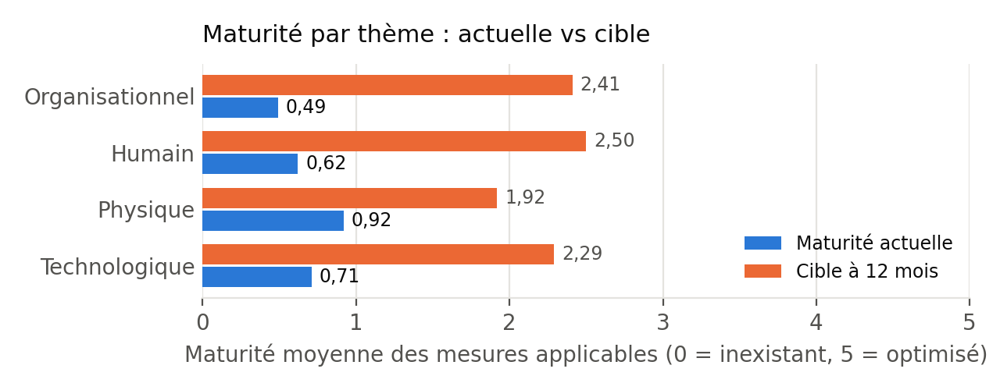
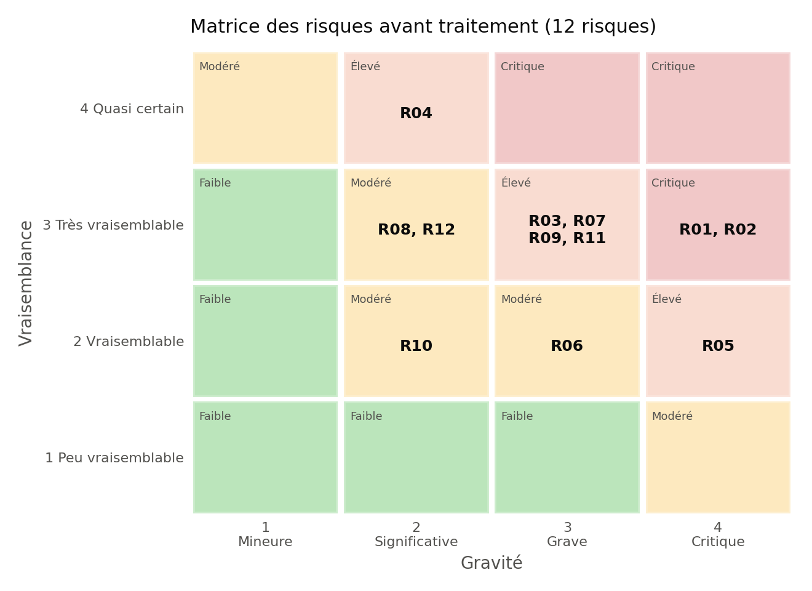
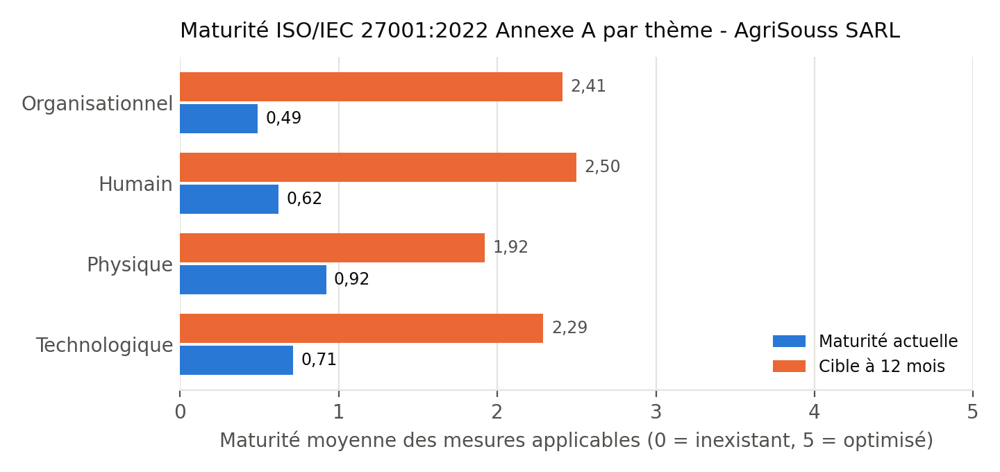

<!-- FICHIER GÉNÉRÉ par build.py à partir de report/rapport_template.md, src/annexa.py et src/register.py. Modifier les sources, pas ce fichier. -->

# Synthèse pour la direction

**À qui s'adresse cette page :** à la gérance d'AgriSouss SARL. Elle résume, sans jargon, ce que l'audit a trouvé et ce qu'il faut faire.

**En une phrase :** l'entreprise fonctionne bien au quotidien, mais sa sécurité repose sur la bonne volonté de quelques personnes et non sur des règles ; **un seul email piégé ou un seul poste infecté pourrait bloquer les ventes et exposer le fichier clients**.

**Niveau actuel :** maturité moyenne **0,64 / 5** (cible à 12 mois : **2,3 / 5**, niveau raisonnable pour une PME de cette taille). 2 risques sont jugés **critiques** et 6 **élevés** sur 12.

{width=13cm}

**Les 4 dangers principaux**

- **Vol du compte email de la gérance** par un faux message (hameçonnage) : accès aux factures, aux clients et aux autres comptes.
- **Rançongiciel** sur le poste comptable : facturation bloquée, et aujourd'hui **aucune sauvegarde testée** pour repartir.
- **Fuite du fichier clients** via une faille du site web, avec une obligation légale (loi 09-08) qui n'est pas encore respectée (pas de déclaration à la CNDP).
- **Faux changement de RIB** d'un fournisseur par email : un virement envoyé à un escroc.

**Ce qu'il faut faire en priorité (30 jours, coût faible)**

1. Activer la double authentification sur **tous** les comptes (email, hébergeur, nom de domaine).
2. Mettre en place des **sauvegardes** dont une hors ligne, et vérifier une fois qu'on sait les restaurer.
3. Supprimer les accès des anciens salariés et prestataires ; un compte par personne.
4. Règle « deux personnes + un appel » pour tout virement ou changement de RIB.
5. Remplacer la clé d'accès exposée dans le code du site et mettre à jour le site.

**Budget indicatif :** 3 500 à 26 000 MAD sur 30 jours, 36 000 à 88 500 MAD sur 90 jours, 18 000 à 40 000 MAD sur 12 mois (estimations hors taxes, à confirmer par devis). À mettre en regard d'un arrêt des ventes de plusieurs jours en haute saison ou d'une sanction de la CNDP.

**Décision attendue :** valider le plan à 30 jours et désigner un **référent sécurité** interne (2 à 4 heures par semaine).

<!-- pagebreak -->

# 1. Contexte, périmètre et méthodologie

## 1.1 Contexte de la mission

> **Étude de cas anonymisée, réalisée dans un cadre académique.** « AgriSouss SARL » est un nom fictif. Les constats sont plausibles pour une PME de ce profil mais ne décrivent aucune entreprise réelle ; aucune donnée réelle (nom, domaine, adresse IP, identifiant) n'est reproduite.

AgriSouss SARL est une PME d'environ **15 salariés** de la région Souss-Massa qui commercialise des produits agricoles (engrais, oligo-éléments, semences) auprès d'exploitants, en direct et via un **site e-commerce** développé en PHP avec une base **MariaDB** chez un **hébergeur mutualisé externe**. Les commandes en ligne sont majoritairement réglées **à la livraison** (pas de paiement par carte sur le site), ce qui exclut du périmètre les exigences de type PCI DSS.

Système d'information observé : 7 postes Windows (dont 2 portables), une box FAI avec Wi-Fi, une imprimante réseau, des comptes Gmail/Google Drive utilisés pour l'activité, des smartphones (dont certains personnels) utilisant WhatsApp pour les commandes, un logiciel de facturation installé localement sur le poste comptable. Le site est maintenu par un **développeur freelance** ; la comptabilité est tenue par un **cabinet externe** ; les livraisons sont confiées à un **transporteur**.

## 1.2 Objectifs

1. Établir un état des lieux de la sécurité de l'information et de la conformité à la loi 09-08.
2. Identifier et hiérarchiser les risques principaux.
3. Proposer un plan d'action réaliste, proportionné au budget d'une PME.

Il ne s'agit **pas** d'un audit de certification ISO/IEC 27001, ni d'un test d'intrusion.

## 1.3 Périmètre

| Inclus | Exclu |
|---|---|
| Organisation et gouvernance de la sécurité | Systèmes internes de l'hébergeur (hors contrat) |
| Postes de travail, Wi-Fi, comptes cloud | Tests d'intrusion actifs sur le site en production |
| Site e-commerce (revue documentaire, configuration observable, entretien avec le prestataire) | Systèmes du transporteur et du cabinet comptable |
| Traitements de données personnelles (clients, prospects, salariés) | Sécurité des produits et des process agricoles |
| Relations avec les prestataires (contrats, accès) | Entrepôt (hors aspects SI) |

## 1.4 Démarche

| Phase | Activités | Livrables |
|---|---|---|
| 1. Cadrage | Réunion de lancement, périmètre, référentiels, planning | Note de cadrage |
| 2. Collecte | Entretiens (gérant, comptable, commercial, prestataire web), visite des locaux, revue documentaire, observation de configurations (sans test intrusif) | Notes d'entretien |
| 3. Analyse | Inventaire des actifs, analyse de risques EBIOS RM allégée, analyse d'écart Annexe A, check-list 09-08 | Registre des risques, tableau d'écart |
| 4. Restitution | Plan d'action priorisé, synthèse direction, rapport | Le présent rapport, DdA (SoA) projet |

**Preuves :** chaque niveau de maturité repose sur un entretien et, quand c'était possible, une observation. Les évaluations restent des **jugements d'auditeur** ; elles ne remplacent pas une vérification technique.

## 1.5 Référentiels utilisés

- **ISO/IEC 27001:2022** : exigences d'un système de management de la sécurité de l'information (SMSI) - clauses 4 à 10 et **Annexe A** (93 mesures en 4 thèmes : organisationnel, humain, physique, technologique). L'amendement ISO/IEC 27001:2022/Amd 1:2024 (prise en compte du changement climatique dans le contexte) est sans effet notable ici.
- **ISO/IEC 27002:2022** : guide de mise en oeuvre des 93 mesures (objectifs, recommandations, attributs).
- **EBIOS Risk Manager** (ANSSI, 2018) : méthode d'appréciation des risques en 5 ateliers, utilisée ici en **version allégée**.
- **Cadre marocain** : loi 05-20, loi 09-08, DNSSI (voir section 2).

## 1.6 Échelles

**Maturité des mesures (0-5)** : 0 Inexistant · 1 Initial/informel · 2 Reproductible mais non documenté · 3 Défini et documenté · 4 Géré et mesuré · 5 Optimisé. Pour une PME, la cible est généralement **2 à 3** ; viser 4-5 serait disproportionné.

**Risques** : Niveau = **Gravité (1-4) × Vraisemblance (1-4)**, soit 1 à 16. Seuils : 1-3 Faible (acceptable), 4-6 Modéré (à surveiller), 8-9 Élevé (à traiter), 12-16 Critique (à traiter en priorité).

<!-- pagebreak -->

# 2. Cadre réglementaire et normatif - applicabilité

| Texte | Objet | Applicable à AgriSouss ? | Utilisation dans l'audit |
|---|---|---|---|
| **Loi n° 09-08** (2009) relative à la protection des personnes physiques à l'égard du traitement des données à caractère personnel, et son décret d'application n° 2-09-165 | Données personnelles ; autorité de contrôle : **CNDP** | **Oui, directement** : l'entreprise traite des données de clients, prospects et salariés | Check-list de conformité (section 6) |
| **Loi n° 05-20** (2020) relative à la cybersécurité, et son décret d'application n° 2-21-406 du 15 juillet 2021 | Sécurité des SI des administrations, collectivités, établissements et entreprises publics, infrastructures d'importance vitale (IIV), certains opérateurs et prestataires | **Non directement** : une SARL privée qui n'est ni IIV, ni opérateur télécom, ni prestataire de services numériques/cybersécurité visé n'entre pas dans le champ des obligations | **Référence de bonnes pratiques** (déclaration d'incident, homologation, audit) |
| **DNSSI** - Directive Nationale de la Sécurité des Systèmes d'Information (DGSSI, 2014) | Mesures de sécurité de référence, largement inspirées de l'ISO/IEC 27001/27002 | **Non obligatoire** : destinée aux administrations, organismes publics et IIV | Référence complémentaire de bonnes pratiques |
| **Code pénal, art. 607-3 à 607-11** (loi n° 07-03 relative aux atteintes aux systèmes de traitement automatisé des données) | Incrimine l'accès frauduleux, l'entrave, l'altération de données | **Oui** (protège l'entreprise victime) | Base des dépôts de plainte ; conservation des preuves (5.28) |
| **ISO/IEC 27001 / 27002:2022** | Normes volontaires | **Volontaire** ; pas de certification visée | Grille d'analyse d'écart et DdA |

**Points d'attention sur l'applicabilité (honnêteté du diagnostic) :**

- La **loi 05-20** désigne la **DGSSI** (Direction Générale de la Sécurité des Systèmes d'Information, rattachée à l'Administration de la Défense Nationale) comme autorité nationale de cybersécurité ; elle impose aux entités assujetties notamment une politique de sécurité, la classification des actifs, la déclaration des incidents et des audits. AgriSouss n'y est pas assujettie ; nous en retenons l'**esprit** (déclarer, se préparer, auditer). Si AgriSouss devenait fournisseur d'une entité assujettie (par exemple un office public), des exigences contractuelles pourraient en découler.
- La **loi 09-08** s'applique pleinement : fichier clients du site, commandes, données de livraison, fichiers RH, éventuelle vidéosurveillance. Des **transferts hors du Maroc** existent de fait (messagerie Gmail/Google Drive, hébergeur dont les serveurs peuvent être à l'étranger) et relèvent du régime des transferts de la loi, qui suppose un pays offrant un niveau de protection suffisant ou une autorisation/dérogation : **point à instruire avec la CNDP**.
- Les numéros d'articles de la loi 09-08 cités en section 6 ont été relus sur le texte consolidé publié par le portail officiel Adala (ministère de la Justice) ; ils restent **à confirmer par un juriste** avant toute utilisation juridique. Un projet de réforme du cadre des données personnelles a été évoqué publiquement : **l'état du droit est à vérifier à la date de l'audit**. Ce rapport ne constitue pas un avis juridique.
- Le **RGPD** européen n'est pas applicable a priori (clientèle marocaine, pas de ciblage de résidents de l'UE).

<!-- pagebreak -->

# 3. Inventaire des actifs

## 3.1 Valeurs métier (EBIOS RM - atelier 1)

| Réf. | Valeur métier | Description | Propriétaire | Besoins D / I / C |
|---|---|---|---|---|
| VM1 | Vente en ligne et prise de commande | Catalogue, panier, commandes, suivi des livraisons | Gérant | Élevé / Élevé / Moyen |
| VM2 | Relation client et données clients | Fichier clients/prospects (nom, téléphone, adresse d'exploitation, historique d'achat) | Responsable commercial | Moyen / Élevé / **Élevé** |
| VM3 | Facturation, comptabilité et paiements fournisseurs | Factures, relevés, virements, RIB fournisseurs | Comptable | Élevé / **Élevé** / Élevé |
| VM4 | Image de marque et contenus produits | Fiches techniques, homologations, photos, référencement | Gérant | Moyen / Élevé / Faible |
| VM5 | Gestion du personnel | Contrats, paie, CNSS, dossiers salariés | Gérant | Faible / Moyen / **Élevé** |

D = disponibilité, I = intégrité, C = confidentialité.

## 3.2 Biens supports

| Réf. | Bien support | Type | Valeurs métier | Localisation | Responsable |
|---|---|---|---|---|---|
| BS01 | Site e-commerce PHP + back-office | Logiciel | VM1, VM2, VM4 | Hébergeur mutualisé externe | Prestataire web |
| BS02 | Base de données MariaDB (commandes, clients) | Données | VM1, VM2 | Hébergeur | Prestataire web |
| BS03 | Panneau d'hébergement, compte du nom de domaine, DNS | Service | VM1, VM4 | Fournisseurs externes | Gérant |
| BS04 | Dépôt de code source (Git) | Logiciel | VM1 | Compte du prestataire | Prestataire web |
| BS05 | Comptes Gmail / Google Drive (9 comptes) | Service cloud | VM2, VM3, VM5 | Cloud (hors Maroc) | Gérant |
| BS06 | Poste comptable + logiciel de facturation local | Matériel / logiciel | VM3, VM5 | Bureau comptable | Comptable |
| BS07 | 4 postes fixes bureau + 2 PC portables | Matériel | Toutes | Bureaux / déplacements | Utilisateurs |
| BS08 | Smartphones (WhatsApp Business, dont appareils personnels) | Matériel | VM1, VM2 | Mobiles | Commerciaux |
| BS09 | Box FAI, Wi-Fi, imprimante réseau | Réseau | Toutes | Couloir des bureaux | Gérant |
| BS10 | Archives papier (factures, bons de livraison, dossiers RH) | Papier | VM3, VM5 | Bureau comptable | Comptable |
| BS11 | Prestataires : développeur freelance, cabinet comptable, transporteur, hébergeur | Organisation | Toutes | Externes | Gérant |
| BS12 | Personnel (15 salariés) | Personnes | Toutes | - | Gérant |

## 3.3 Événements redoutés

| Réf. | Événement redouté | Valeur métier | Impacts | Gravité |
|---|---|---|---|---|
| ER1 | Indisponibilité du site et des commandes > 48 h en haute saison | VM1 | Perte de chiffre d'affaires, clients reportés vers la concurrence | 3 Grave |
| ER2 | Divulgation du fichier clients | VM2 | Non-conformité 09-08, atteinte à la réputation, démarchage des clients par un concurrent | 3 Grave |
| ER3 | Perte ou chiffrement des données comptables | VM3 | Arrêt de la facturation, difficultés fiscales, trésorerie | 4 Critique |
| ER4 | Détournement de paiement (faux RIB) | VM3 | Perte financière directe, souvent non récupérable | 3 Grave |
| ER5 | Altération du site (défiguration, contenu malveillant) | VM4 | Réputation, déréférencement | 2 Significative |
| ER6 | Prise de contrôle des comptes de messagerie | VM2, VM3 | Usurpation de l'entreprise, rebond vers clients et fournisseurs | 4 Critique |

## 3.4 Socle de sécurité (synthèse)

Le socle a été évalué par rapport à l'Annexe A de l'ISO/IEC 27001:2022 (section 5) et à la loi 09-08 (section 6). Il est **faible** : pas de politique, pas de MFA généralisée, pas de sauvegarde testée, droits d'administration généralisés. Les points positifs sont réels : HTTPS actif, antivirus natif présent, paiement à la livraison (pas de données de carte), petite surface d'attaque, direction réceptive.

<!-- pagebreak -->

# 4. Analyse de risques (EBIOS Risk Manager allégée)

## 4.1 Ce qui a été allégé

Les 5 ateliers ont été suivis, de façon condensée (une demi-journée d'atelier avec la gérance au lieu de plusieurs séances) : pas de cartographie détaillée de l'écosystème avec cotation de dangerosité, scénarios opérationnels décrits en texte plutôt qu'en graphes d'attaque complets. Les risques **accidentels** (panne, erreur), que l'EBIOS RM traite surtout via le socle de sécurité, sont intégrés au registre pour donner à la direction une vue unique.

## 4.2 Atelier 2 - Sources de risque et objectifs visés

| Réf. | Source de risque | Objectif visé | Motivation / ressources | Pertinence |
|---|---|---|---|---|
| SR1 | Cybercriminel opportuniste | Rançon, revente d'accès ou de données | Élevée / outils automatisés | **Élevée** |
| SR2 | Fraudeur (ingénierie sociale) | Détourner un virement | Élevée / faibles moyens techniques | **Élevée** |
| SR3 | Hacktiviste / défaceur | Visibilité, défiguration | Moyenne / scans de masse | Moyenne |
| SR4 | Ancien salarié ou prestataire mécontent | Nuire, conserver un avantage | Faible à moyenne / **accès légitimes conservés** | Moyenne |
| SR5 | Concurrent peu scrupuleux | Obtenir le fichier clients | Faible / sous-traitance possible | Faible |
| SR6 | Voleur opportuniste | Revente du matériel | Moyenne | Moyenne |

## 4.3 Atelier 3 - Écosystème et scénarios stratégiques

Parties prenantes critiques : **hébergeur** (dépendance totale du site), **développeur freelance** (accès complet, aucun contrat), **Google** (messagerie et documents), **cabinet comptable** (échanges de fichiers par clé USB/email), **transporteur** (reçoit noms, téléphones et adresses des clients).

| Réf. | Scénario stratégique | Chemin | Événement redouté |
|---|---|---|---|
| SS1 | Un cybercriminel prend le contrôle de la messagerie de la gérance et l'utilise pour accéder aux autres comptes et frauder | SR1 → gérant (hameçonnage) → Gmail → réinitialisation hébergeur/domaine | ER6, ER1, ER4 |
| SS2 | Un cybercriminel chiffre le poste comptable via une pièce jointe piégée | SR1 → salarié → poste comptable (admin local) → fichiers de facturation | ER3 |
| SS3 | Un attaquant exploite une faille du site pour extraire la base clients | SR1/SR5 → site PHP (version obsolète, injection) → MariaDB | ER2, ER5 |
| SS4 | Un fraudeur se fait passer pour un fournisseur et obtient un changement de RIB | SR2 → comptable (email usurpé) → virement | ER4 |
| SS5 | Un ancien prestataire réutilise ses accès conservés | SR4 → panneau d'hébergement / dépôt Git | ER1, ER5, ER2 |

## 4.4 Atelier 4 - Scénarios opérationnels (principaux)

**SO1 (pour SS1) - Hameçonnage de la gérance.** (1) Reconnaissance : adresse email publique sur le site. (2) Email imitant une alerte Google ou une facture d'un fournisseur. (3) Saisie du mot de passe sur une fausse page ; absence de MFA. (4) Création d'une règle de transfert discrète dans la boîte. (5) Réinitialisation du mot de passe de l'hébergeur et du domaine via l'adresse compromise. (6) Fraude ou rançon. *Vraisemblance : 3 (très vraisemblable) - un salarié a déjà saisi son mot de passe sur une fausse page.*

**SO2 (pour SS2) - Rançongiciel.** (1) Pièce jointe Office ou archive piégée. (2) Exécution avec des droits d'administrateur local. (3) Désactivation de l'antivirus, chiffrement du disque et des clés USB connectées. (4) Aucune sauvegarde hors ligne → perte ou paiement. *Vraisemblance : 3.*

**SO3 (pour SS3) - Injection SQL.** (1) Scan automatisé du site, détection d'une version PHP en fin de support. (2) Paramètre vulnérable à l'injection SQL (concaténation identifiée lors de l'entretien avec le prestataire). (3) Extraction de la table clients. (4) Revente ou publication. *Vraisemblance : 3 - à confirmer par un test autorisé (action A17).*

**SO4 (pour SS4) - Faux RIB.** (1) Compromission ou imitation de l'adresse d'un fournisseur. (2) Email « nouveau RIB » au comptable. (3) Aucun contre-appel ni double validation. (4) Virement perdu. *Vraisemblance : 3.*

## 4.5 Registre des risques

| Réf. | Risque | Source de risque | G | V | Niveau | Mesures Annexe A |
|---|---|---|---|---|---|---|
| R01 | Prise de contrôle du compte Google de la gérance par hameçonnage | SR1 Cybercriminel opportuniste | 4 | 3 | 12 Critique | 5.17, 5.23, 6.3, 8.5 |
| R02 | Rançongiciel sur le poste comptable / partage de fichiers | SR1 Cybercriminel opportuniste | 4 | 3 | 12 Critique | 8.1, 8.2, 8.7, 8.8, 8.13 |
| R03 | Exfiltration de la base clients via une vulnérabilité du site PHP (injection SQL) | SR1 Cybercriminel opportuniste / SR5 Concurrent | 3 | 3 | 9 Élevé | 8.8, 8.26, 8.28, 8.29 |
| R04 | Abus d'une clé d'API tierce exposée dans l'historique Git (« denial of wallet ») | SR1 Cybercriminel opportuniste | 2 | 4 | 8 Élevé | 8.4, 8.24, 8.30 |
| R05 | Compromission du compte de l'hébergeur / du domaine (identifiants partagés, sans MFA) | SR1 Cybercriminel / SR4 Ancien prestataire | 4 | 2 | 8 Élevé | 5.16, 5.17, 8.2, 8.5 |
| R06 | Perte durable des données du site faute de sauvegarde exploitable | Accident / erreur (hors sources intentionnelles EBIOS) | 3 | 2 | 6 Modéré | 5.30, 5.37, 8.13, 8.14 |
| R07 | Fraude au faux fournisseur / changement de RIB par email usurpé | SR2 Fraudeur | 3 | 3 | 9 Élevé | 5.3, 5.14, 6.3 |
| R08 | Défiguration ou injection de contenu malveillant (XSS, SEO spam) sur le site | SR3 Hacktiviste / défaceur | 2 | 3 | 6 Modéré | 8.9, 8.25, 8.28, 8.29 |
| R09 | Non-conformité à la loi 09-08 (absence de déclaration CNDP, transferts hors Maroc non encadrés) | Exigence réglementaire (contrôle CNDP, plainte client) | 3 | 3 | 9 Élevé | 5.20, 5.31, 5.34, 8.10, 8.11 |
| R10 | Intrusion sur le réseau local via le Wi-Fi (clé partagée, box non durcie) | SR4 Ancien employé / SR1 opportuniste à proximité | 2 | 2 | 4 Modéré | 8.9, 8.20, 8.22 |
| R11 | Accès persistants d'anciens salariés ou prestataires | SR4 Ancien employé / prestataire mécontent | 3 | 3 | 9 Élevé | 5.11, 5.18, 6.5, 8.30 |
| R12 | Vol ou perte d'un PC portable / smartphone non chiffré contenant des données clients | SR6 Voleur opportuniste | 2 | 3 | 6 Modéré | 7.9, 8.1, 8.24 |

## 4.6 Matrice des risques (avant traitement)

| Vraisemblance \ Gravité | G1 Mineure | G2 Significative | G3 Grave | G4 Critique |
|---|---|---|---|---|
| V4 Quasi certain | - | R04 | - | - |
| V3 Très vraisemblable | - | R08 R12 | R03 R07 R09 R11 | R01 R02 |
| V2 Vraisemblable | - | R10 | R06 | R05 |
| V1 Peu vraisemblable | - | - | - | - |

{width=12.5cm}

## 4.7 Atelier 5 - Stratégie de traitement

Tous les risques **critiques et élevés** sont **réduits** par le plan d'action (section 7). Aucun risque n'est transféré à ce stade ; une **cyber-assurance** pourra être étudiée une fois les mesures de base en place (les assureurs exigent généralement MFA et sauvegardes). Le risque résiduel R12 (vol d'un portable) reste « très vraisemblable » (V3), mais sa gravité devient mineure grâce au chiffrement ; il est **accepté**. Les niveaux résiduels supposent que les actions soient effectivement réalisées et vérifiées.

| Réf. | Niveau initial | Actions | Niveau résiduel visé | Décision |
|---|---|---|---|---|
| R01 | 12 Critique | A01, A03, A12, A16, A18, A19 | 4 Modéré | Réduit puis accepté (surveillance) |
| R02 | 12 Critique | A04, A09, A12, A16, A20 | 3 Faible | Accepté après traitement |
| R03 | 9 Élevé | A05, A16, A17, A18, A21, A23 | 3 Faible | Accepté après traitement |
| R04 | 8 Élevé | A02 | 2 Faible | Accepté après traitement |
| R05 | 8 Élevé | A01, A03, A08, A18 | 4 Modéré | Réduit puis accepté (surveillance) |
| R06 | 6 Modéré | A04, A20 | 3 Faible | Accepté après traitement |
| R07 | 9 Élevé | A07, A12 | 3 Faible | Accepté après traitement |
| R08 | 6 Modéré | A05, A17, A21, A23 | 2 Faible | Accepté après traitement |
| R09 | 9 Élevé | A10, A13, A14, A15, A19 | 2 Faible | Accepté après traitement |
| R10 | 4 Modéré | A06 | 2 Faible | Accepté après traitement |
| R11 | 9 Élevé | A08, A11, A14, A19 | 3 Faible | Accepté après traitement |
| R12 | 6 Modéré | A09 | 3 Faible | Accepté après traitement |

<!-- pagebreak -->

# 5. Analyse d'écart ISO/IEC 27001:2022 - Annexe A

## 5.1 Clauses 4 à 10 (SMSI) - aperçu

| Clause | Exigence (résumé) | Constat | Maturité |
|---|---|---|---|
| 4 Contexte | Enjeux, parties intéressées, périmètre du SMSI | Non formalisés (ce rapport en fournit une première version) | 0 |
| 5 Leadership | Engagement de la direction, politique, rôles | Direction réceptive, aucune politique ni rôle | 1 |
| 6 Planification | Appréciation et traitement des risques, objectifs, DdA | Première appréciation réalisée par cet audit | 1 |
| 7 Support | Ressources, compétences, sensibilisation, documentation | Pas de sensibilisation ni de documentation | 0 |
| 8 Fonctionnement | Mise en oeuvre du traitement des risques | Mesures ponctuelles non pilotées | 1 |
| 9 Évaluation | Surveillance, audit interne, revue de direction | Inexistant | 0 |
| 10 Amélioration | Non-conformités, actions correctives | Inexistant | 0 |

Une certification n'est **pas recommandée** à court terme : le coût (accompagnement, audit de certification, maintien) serait disproportionné. L'objectif est d'adopter la logique de la norme (risques → mesures → vérification) à l'échelle d'une PME.

## 5.2 Maturité par thème

| Thème | Mesures | Applicables | Maturité actuelle | Cible 12 mois | Écart |
|---|---|---|---|---|---|
| Organisationnel (5.1-5.37) | 37 | 37 | 0.49 | 2.41 | 1.92 |
| Humain (6.1-6.8) | 8 | 8 | 0.62 | 2.50 | 1.88 |
| Physique (7.1-7.14) | 14 | 13 | 0.92 | 1.92 | 1.00 |
| Technologique (8.1-8.34) | 34 | 34 | 0.71 | 2.29 | 1.58 |
| **Global (pondéré)** | **93** | **92** | **0.64** | **2.30** | **1.66** |

{width=15.5cm}

## 5.3 Principaux écarts (priorité P1)

22 mesures sont classées P1 (à traiter dans les 90 jours) :

| Mesure | Constat | Recommandation | Mat. | Risques |
|---|---|---|---|---|
| 5.1 Politiques de sécurité de l'information | Aucune politique écrite ; règles transmises oralement par le gérant. | Rédiger une PSSI courte (5-8 pages) validée par la gérance, + charte utilisateur. | 0→3 | Tous |
| 5.2 Rôles et responsabilités | Le gérant et le prestataire web gèrent 'l'informatique' sans rôles définis. | Nommer un référent sécurité interne (temps partiel) et formaliser une matrice RACI. | 1→3 | Tous |
| 5.3 Séparation des tâches | La même personne saisit et valide les virements fournisseurs. | Double validation des virements et des changements de RIB fournisseur. | 1→3 | R07 |
| 5.9 Inventaire des informations et actifs | Pas d'inventaire ; les PC et comptes sont connus 'de mémoire'. | Tenir un inventaire (tableur) : matériels, comptes, logiciels, données, propriétaire. | 1→3 | Tous |
| 5.15 Contrôle d'accès | Accès donnés 'à la demande', pas de règle du moindre privilège. | Politique de contrôle d'accès : besoin d'en connaître + revue semestrielle. | 1→3 | R01, R05, R11 |
| 5.16 Gestion des identités | Compte du panneau d'hébergement et compte admin du site partagés par 3 personnes. | Comptes nominatifs uniquement ; suppression des comptes partagés. | 1→3 | R05, R11 |
| 5.17 Informations d'authentification | Mots de passe réutilisés, notés sur papier ; pas de gestionnaire de mots de passe. | Gestionnaire de mots de passe d'équipe + règles de longueur (phrases de passe). | 1→3 | R01, R05 |
| 5.18 Droits d'accès | Un ancien stagiaire et l'ancien prestataire disposent encore d'accès. | Procédure arrivée/départ + revue des droits tous les 6 mois. | 1→3 | R11 |
| 5.20 Sécurité dans les accords fournisseurs | Pas de contrat écrit avec le freelance web ; CGV standard de l'hébergeur. | Clauses sécurité, confidentialité et sous-traitance 09-08 dans les contrats. | 0→3 | R03, R09 |
| 5.23 Sécurité pour l'utilisation des services cloud | Comptes Gmail gratuits utilisés pour l'activité ; Drive partagé par liens publics. | Règles d'usage cloud : comptes professionnels, MFA, partage restreint, localisation des données. | 1→3 | R01, R09 |
| 5.31 Exigences légales et contractuelles | Obligations 09-08 méconnues ; aucun registre des exigences. | Registre des exigences : loi 09-08, code pénal (STAD), droit de la consommation, contrats. | 1→3 | R09 |
| 5.34 Vie privée et protection des DCP | Aucune déclaration CNDP, pas de politique de confidentialité sur le site. | Mise en conformité 09-08 (voir check-list dédiée). | 0→3 | R03, R09 |
| 6.3 Sensibilisation, éducation et formation | Aucune sensibilisation ; un employé a déjà saisi son mot de passe sur une fausse page. | Session annuelle de 2 h + rappels trimestriels + exercice de phishing simulé. | 0→3 | R01, R02, R07 |
| 8.1 Terminaux utilisateurs | 7 postes Windows (dont 2 portables) hétérogènes ; un poste sous Windows 10 (fin de support oct. 2025). | Standard de configuration des postes ; remplacer/mettre à niveau le poste Windows 10. | 1→3 | R02, R12 |
| 8.2 Droits d'accès privilégiés | Tous les utilisateurs sont administrateurs locaux de leur poste. | Comptes utilisateurs standards ; un compte admin séparé par poste. | 0→3 | R02, R05 |
| 8.4 Accès au code source | Code du site dans un dépôt Git du prestataire ; un secret (clé d'API tierce) présent dans l'historique. | Dépôt privé propriété d'AgriSouss ; secrets hors dépôt ; rotation de la clé. | 1→3 | R04, R08 |
| 8.5 Authentification sécurisée | MFA activée sur 2 comptes Google sur 9 ; pas de MFA sur l'hébergeur ni le bureau d'enregistrement du domaine. | MFA obligatoire sur messagerie, hébergeur, domaine, back-office. | 1→3 | R01, R05 |
| 8.8 Gestion des vulnérabilités techniques | Version de PHP en fin de support sur l'hébergement ; mises à jour Windows reportées. | Mises à jour automatiques ; montée de version PHP ; scan de vulnérabilités trimestriel. | 1→3 | R02, R03, R08 |
| 8.13 Sauvegarde des informations | Sauvegardes automatiques de l'hébergeur (rétention inconnue) ; PC comptable non sauvegardé ; aucun test de restauration. | Règle 3-2-1 : export BDD quotidien + copie hors hébergeur + copie hors ligne ; test trimestriel. | 1→3 | R02, R06 |
| 8.20 Sécurité des réseaux | Box FAI : WPS activé, clé Wi-Fi partagée depuis plusieurs années, interface d'administration avec mot de passe par défaut. | Changer le mot de passe admin, désactiver WPS, WPA2/WPA3 avec clé forte, firmware à jour. | 1→3 | R10 |
| 8.28 Codage sécurisé | Code PHP hétérogène : requêtes préparées sur la plupart des pages, mais quelques concaténations SQL et sorties non échappées. | Requêtes préparées partout, échappement des sorties, jetons CSRF, revue de code. | 1→3 | R03, R08 |
| 8.30 Développement externalisé | Freelance sans contrat écrit, accès complet, pas de livrable documenté. | Contrat avec exigences sécurité, propriété du code, restitution des accès. | 0→3 | R03, R04, R11 |

Le tableau complet des 93 mesures (état actuel, maturité, écart, priorité, risques liés) est fourni dans `outputs/gap_analysis_annexA.xlsx` / `.csv` ; le projet de Déclaration d'applicabilité figure en annexe A.

<!-- pagebreak -->

# 6. Conformité à la loi 09-08 - check-list

Légende : ✔ conforme · ◐ partiel · ✘ non conforme · ? à vérifier. Références d'articles relues sur le texte consolidé de la loi (voir réserve en section 2).

| # | Exigence | Réf. indicative | Constat | Statut | Action |
|---|---|---|---|---|---|
| 1 | Recenser les traitements (clients/prospects, commandes, RH/paie, éventuelle vidéosurveillance) | Bonne pratique (préalable aux formalités) | Aucun registre | ✘ | A15 |
| 2 | **Déclaration préalable** à la CNDP (ou demande d'autorisation pour les traitements qui l'exigent) | Art. 12 et s. | Aucune déclaration effectuée | ✘ | A13 |
| 3 | Finalités déterminées, données adéquates et non excessives (minimisation) | Art. 3 | Le formulaire demande la CIN, inutile pour une livraison | ◐ | A10 |
| 4 | **Consentement** de la personne ou autre base légale (exécution du contrat, obligation légale...) | Art. 4 | Commandes : exécution du contrat (OK). Newsletter/WhatsApp promotionnels : pas de consentement recueilli | ◐ | A10 |
| 5 | **Information** des personnes lors de la collecte (identité du responsable, finalités, destinataires, droits) | Art. 5 | Pas de politique de confidentialité ni de mention sur les formulaires | ✘ | A10 |
| 6 | Droits d'accès, de rectification et d'opposition ; point de contact | Art. 7 à 9 | Aucune procédure ni adresse dédiée | ✘ | A10 |
| 7 | Prospection directe par email/SMS/messagerie : consentement préalable | Art. 10 | Messages promotionnels envoyés à tout le fichier | ✘ | A10 |
| 8 | **Cookies** et traceurs : information et choix de l'utilisateur | Pas de disposition spécifique identifiée dans la loi (principes d'information et de consentement) - position CNDP à vérifier | Outil de mesure d'audience déposé sans bandeau | ✘ | A10 |
| 9 | **Durées de conservation** définies et appliquées | Art. 3 | Commandes conservées sans limite | ✘ | A15 |
| 10 | **Sécurité** des traitements (mesures techniques et organisationnelles) | Art. 23 | Voir sections 4 et 5 : MFA, sauvegarde, droits insuffisants | ✘ | A01-A09 |
| 11 | **Sous-traitants** : garanties de sécurité et contrat écrit (hébergeur, prestataire web, transporteur, cabinet comptable) | Art. 23 §2 à 4 (choix du sous-traitant, contrat écrit) | Aucun contrat avec clauses de protection des données | ✘ | A14 |
| 12 | **Transferts vers l'étranger** (Google, hébergeur) : pays adéquat, ou autorisation/dérogation | Art. 43 et 44 | Localisation des données non connue ; aucune démarche | ? | A13 |
| 13 | Confidentialité : personnel habilité, engagement de confidentialité | Art. 25 (instructions) et 26 (secret professionnel) | Pas de clause de confidentialité dans les contrats | ✘ | A11, A14 |
| 14 | Données des salariés (RH) : information, accès restreint | Art. 3 à 5 | Dossiers RH dans un dossier Drive partagé | ◐ | A11, A13 |
| 15 | Vidéosurveillance éventuelle : déclaration et affichage | Formalités CNDP | Pas de caméra dans les bureaux à ce jour | ✔ | Si installation : déclarer |
| 16 | Gestion des violations de données : procédure interne, information de la CNDP si pertinent | Pas d'obligation générale de notification identifiée dans la loi de 2009 (contrairement au RGPD) - bonne pratique | Aucune procédure | ✘ | A16 |

**Lecture :** la conformité 09-08 est **faible mais rapidement améliorable** : la plupart des actions sont documentaires (déclarations, mentions, contrats) et peu coûteuses. La loi 09-08 n'impose pas, à notre connaissance, la désignation d'un délégué à la protection des données ; nommer un **interlocuteur interne** reste recommandé. La sanction la plus probable n'est pas une amende mais une **plainte client** ou une **perte de confiance** ; les sanctions administratives et pénales prévues par la loi existent néanmoins.

<!-- pagebreak -->

# 7. Plan d'action priorisé

**Principes de priorisation :** (1) réduire d'abord les risques critiques ; (2) privilégier les actions à fort effet et faible coût ; (3) rester réaliste pour une équipe sans informaticien interne. Coûts : **estimations indicatives en MAD HT** (prix de marché observés pour des prestations de PME, hypothèse 1 USD ≈ 10 MAD), à confirmer par devis. « j » = jour de travail.

## Horizon 1 - Quick wins (0 à 30 jours)

| Réf. | Action | Effort | Coût estimé (MAD HT) | Porteur | Risques |
|---|---|---|---|---|---|
| A01 | Activer la MFA sur tous les comptes Google, l'hébergeur, le bureau d'enregistrement du domaine et le back-office | 1 j | 0 | Référent sécurité | R01, R05 |
| A02 | Révoquer et régénérer la clé d'API exposée ; retirer les secrets du dépôt et de son historique ; .env hors dépôt | 0,5 j | 0 - 1 000 | Prestataire web | R04 |
| A03 | Déployer un gestionnaire de mots de passe d'équipe ; changer les mots de passe partagés | 1 j | 0 - 6 000 / an | Référent sécurité | R01, R05 |
| A04 | Sauvegarde 3-2-1 : export BDD quotidien, copie hors hébergeur, disque externe hors ligne pour la compta ; 1er test de restauration | 2 j | 1 000 - 2 500 | Prestataire web + Référent | R02, R06 |
| A05 | Monter la version de PHP vers une branche supportée ; ajouter les en-têtes HTTP de sécurité (CSP, HSTS, X-Content-Type-Options, frame-ancestors) | 1-2 j | 1 500 - 4 000 | Prestataire web | R03, R08 |
| A06 | Durcir la box : mot de passe admin, WPS désactivé, WPA2/WPA3 clé forte, réseau invité séparé | 0,5 j | 0 - 1 500 | Référent sécurité | R10 |
| A07 | Procédure anti-fraude : double validation des virements, contre-appel sur numéro connu pour tout changement de RIB | 0,5 j | 0 | Gérance | R07 |
| A08 | Revue des comptes : supprimer les accès des anciens salariés/prestataires, comptes nominatifs, droits admin retirés | 1 j | 0 | Référent sécurité | R05, R11 |
| A09 | Postes : mises à jour automatiques, Defender vérifié, verrouillage d'écran, chiffrement des portables ; remplacer le poste Windows 10 | 2 j | 0 - 8 000 | Référent + réparateur | R02, R12 |
| A10 | Site : politique de confidentialité, mentions d'information 09-08 sur les formulaires, bandeau cookies avec choix | 1-2 j | 1 000 - 3 000 | Gérance + Prestataire web | R09 |

## Horizon 2 - Structurer (30 à 90 jours)

| Réf. | Action | Effort | Coût estimé (MAD HT) | Porteur | Risques |
|---|---|---|---|---|---|
| A11 | PSSI simplifiée + charte informatique signée (annexée au règlement intérieur) + procédure arrivée/départ | 3-5 j | 5 000 - 12 000 | Gérance + consultant | Tous |
| A12 | Sensibilisation (session 2 h) + campagne de phishing simulé interne (outil open source) | 2 j | 3 000 - 6 000 | Consultant | R01, R02, R07 |
| A13 | Déclarations CNDP des traitements (clients/prospects, RH) et démarche pour les transferts de données hors Maroc | 2-3 j | 0 - 5 000 (accompagnement) | Gérance | R09 |
| A14 | Contrats/avenants avec hébergeur, prestataire web, transporteur, cabinet comptable : clauses sécurité, confidentialité, sous-traitance 09-08 | 2 j | 3 000 - 8 000 (juriste) | Gérance + juriste | R09, R11 |
| A15 | Inventaire des actifs + registre des traitements + durées de conservation et purge des anciennes commandes | 2 j | 0 | Référent sécurité | R09 |
| A16 | Fiche réflexe incident (contacts hébergeur, prestataire, maCERT, CNDP, police) + registre des incidents | 1 j | 0 - 2 000 | Référent + consultant | R01, R02, R03 |
| A17 | Audit de sécurité applicatif du site (revue de code + test d'intrusion autorisé) et correction des injections SQL/XSS | 5-8 j | 25 000 - 50 000 | Prestataire qualifié | R03, R08 |
| A18 | Journalisation : connexions back-office, alertes de connexion Google, surveillance de disponibilité gratuite | 1-2 j | 0 - 3 000 | Prestataire web | R01, R03, R05 |
| A23 | Mettre le site derrière un CDN/WAF (offre gratuite ou d'entrée de gamme) ; verrou de transfert du domaine | 0,5 j | 0 - 2 500 / an | Prestataire web | R08, R03 |

## Horizon 3 - Pérenniser (3 à 12 mois)

| Réf. | Action | Effort | Coût estimé (MAD HT) | Porteur | Risques |
|---|---|---|---|---|---|
| A19 | Migrer de Gmail gratuit vers une offre professionnelle administrable (console, MFA imposée, récupération des comptes) | 3 j | 10 000 - 15 000 / an (15 utilisateurs) | Gérance + prestataire | R01, R09, R11 |
| A20 | PCA/PRA simplifié (RTO/RPO, mode dégradé) + test de restauration annuel documenté | 3 j | 3 000 - 8 000 | Référent + consultant | R02, R06 |
| A21 | Cycle de développement sécurisé avec le prestataire : dépôt privé, préproduction, revue, journal des changements | 4 j | 5 000 - 12 000 | Prestataire web | R03, R08 |
| A22 | Revue de direction annuelle avec indicateurs (MFA %, sauvegardes testées, mises à jour) + revue indépendante à 24 mois | 1 j / an | 0 - 5 000 | Gérance | Tous |

**Budget indicatif cumulé** (fourchettes, hors temps interne) :

| Horizon | Fourchette basse (MAD) | Fourchette haute (MAD) |
|---|---|---|
| Quick wins (0 à 30 jours) | 3 500 | 26 000 |
| Structurer (30 à 90 jours) | 36 000 | 88 500 |
| Pérenniser (3 à 12 mois) | 18 000 | 40 000 |
| **Total première année** | **57 500** | **154 500** |

Les postes « / an » (gestionnaire de mots de passe, messagerie professionnelle, CDN) sont récurrents.

**Indicateurs de suivi proposés :** % de comptes avec MFA (cible 100 %) ; date du dernier test de restauration réussi (< 3 mois) ; nombre de postes à jour (100 %) ; nombre de comptes d'anciens salariés actifs (0) ; taux de clic à la campagne de phishing (en baisse) ; déclarations CNDP déposées (oui/non).

<!-- pagebreak -->

# 8. Conclusion

AgriSouss SARL présente un profil typique de PME : des outils simples, une forte dépendance à quelques personnes et à des prestataires non encadrés, et une sécurité qui n'a jamais été pilotée. Les risques les plus graves (prise de contrôle de la messagerie, rançongiciel, fuite du fichier clients, fraude au virement) sont **courants et bien documentés**, et les mesures qui les réduisent le plus sont **peu coûteuses** : MFA, sauvegardes testées, suppression des comptes partagés, double validation des paiements, mise à jour du site.

Le plan proposé ne vise pas la certification ISO/IEC 27001 mais une **maturité moyenne d'environ 2,3 / 5** en 12 mois (niveau 3 « défini » sur les mesures prioritaires), la **mise en conformité 09-08** et une capacité minimale à réagir à un incident. Un point d'étape à 90 jours est recommandé pour mesurer l'avancement avec les indicateurs ci-dessus.

## Limites de l'audit

- Étude de cas **fictive et anonymisée** réalisée dans un cadre académique ; elle n'a pas la valeur d'un audit réalisé par un prestataire qualifié.
- Aucun test technique intrusif ; les vulnérabilités applicatives (SO3) sont **présumées** à partir d'entretiens et doivent être confirmées par un test autorisé.
- Les références juridiques sont données à titre indicatif et doivent être vérifiées par un juriste ; elles ne constituent pas un avis juridique.
- Les coûts sont des ordres de grandeur.

<!-- pagebreak -->

# Annexe A - Projet de Déclaration d'applicabilité (DdA / SoA)

La DdA, exigée par l'ISO/IEC 27001:2022 (clause 6.1.3 d), liste les mesures nécessaires, la justification de leur inclusion ou exclusion et leur état de mise en oeuvre. Ce projet couvre les 93 mesures de l'Annexe A ; **92 mesures retenues, 1 exclusion(s)** avec justification. Intitulés en anglais (texte de la norme) ; libellés français de l'audit = traduction de travail non officielle.

## A.5 Organisationnel (5.1-5.37)

| ID | Mesure (EN) | Appl. | Justification | État | Actions |
|---|---|---|---|---|---|
| 5.1 | Policies for information security | Oui | Socle de gouvernance - tous risques | Non mis en oeuvre | A11 |
| 5.2 | Information security roles and responsibilities | Oui | Socle de gouvernance - tous risques | Partiel | - |
| 5.3 | Segregation of duties | Oui | Traitement des risques R07 | Partiel | A07 |
| 5.4 | Management responsibilities | Oui | Socle de gouvernance - tous risques | Partiel | A22 |
| 5.5 | Contact with authorities | Oui | Traitement des risques R03, R09 | Non mis en oeuvre | A16 |
| 5.6 | Contact with special interest groups | Oui | Bonne pratique de base (socle) | Non mis en oeuvre | - |
| 5.7 | Threat intelligence | Oui | Traitement des risques R01, R02 | Non mis en oeuvre | - |
| 5.8 | Information security in project management | Oui | Traitement des risques R03, R08 | Non mis en oeuvre | - |
| 5.9 | Inventory of information and other associated assets | Oui | Socle de gouvernance - tous risques | Partiel | A15 |
| 5.10 | Acceptable use of information and other associated assets | Oui | Traitement des risques R01, R02, R12 | Non mis en oeuvre | A11 |
| 5.11 | Return of assets | Oui | Traitement des risques R11, R12 | Partiel | - |
| 5.12 | Classification of information | Oui | Traitement des risques R03 | Non mis en oeuvre | A15 |
| 5.13 | Labelling of information | Oui | Bonne pratique de base (socle) | Non mis en oeuvre | - |
| 5.14 | Information transfer | Oui | Traitement des risques R03, R07 | Partiel | A07 |
| 5.15 | Access control | Oui | Traitement des risques R01, R05, R11 | Partiel | - |
| 5.16 | Identity management | Oui | Traitement des risques R05, R11 | Partiel | A08 |
| 5.17 | Authentication information | Oui | Traitement des risques R01, R05 | Partiel | A01, A03 |
| 5.18 | Access rights | Oui | Traitement des risques R11 | Partiel | A08 |
| 5.19 | Information security in supplier relationships | Oui | Traitement des risques R05, R06, R11 | Non mis en oeuvre | A14 |
| 5.20 | Addressing information security within supplier agreements | Oui | Traitement des risques R03, R09 | Non mis en oeuvre | A14 |
| 5.21 | Managing information security in the ICT supply chain | Oui | Traitement des risques R03, R08 | Partiel | - |
| 5.22 | Monitoring, review and change management of supplier services | Oui | Traitement des risques R06 | Non mis en oeuvre | - |
| 5.23 | Information security for use of cloud services | Oui | Traitement des risques R01, R09 | Partiel | A19 |
| 5.24 | Information security incident management planning and preparation | Oui | Traitement des risques R01, R02, R03 | Non mis en oeuvre | A16 |
| 5.25 | Assessment and decision on information security events | Oui | Traitement des risques R01, R02 | Non mis en oeuvre | - |
| 5.26 | Response to information security incidents | Oui | Traitement des risques R02, R03 | Non mis en oeuvre | A16 |
| 5.27 | Learning from information security incidents | Oui | Bonne pratique de base (socle) | Non mis en oeuvre | - |
| 5.28 | Collection of evidence | Oui | Traitement des risques R03, R07 | Non mis en oeuvre | - |
| 5.29 | Information security during disruption | Oui | Traitement des risques R02, R06 | Non mis en oeuvre | A20 |
| 5.30 | ICT readiness for business continuity | Oui | Traitement des risques R02, R06 | Non mis en oeuvre | A04, A20 |
| 5.31 | Legal, statutory, regulatory and contractual requirements | Oui | Exigence légale (loi 09-08) et contractuelle | Partiel | A13 |
| 5.32 | Intellectual property rights | Oui | Bonne pratique de base (socle) | Partiel | - |
| 5.33 | Protection of records | Oui | Obligations comptables et fiscales de conservation | Partiel | - |
| 5.34 | Privacy and protection of PII | Oui | Exigence légale (loi 09-08, CNDP) - données clients | Non mis en oeuvre | A10, A13 |
| 5.35 | Independent review of information security | Oui | Bonne pratique de base (socle) | Non mis en oeuvre | A22 |
| 5.36 | Compliance with policies, rules and standards for information security | Oui | Bonne pratique de base (socle) | Non mis en oeuvre | A22 |
| 5.37 | Documented operating procedures | Oui | Traitement des risques R06 | Partiel | - |

## A.6 Humain (6.1-6.8)

| ID | Mesure (EN) | Appl. | Justification | État | Actions |
|---|---|---|---|---|---|
| 6.1 | Screening | Oui | Traitement des risques R11 | Partiel | - |
| 6.2 | Terms and conditions of employment | Oui | Traitement des risques R11 | Partiel | A11 |
| 6.3 | Information security awareness, education and training | Oui | Traitement des risques R01, R02, R07 | Non mis en oeuvre | A12 |
| 6.4 | Disciplinary process | Oui | Bonne pratique de base (socle) | Partiel | A11 |
| 6.5 | Responsibilities after termination or change of employment | Oui | Traitement des risques R11 | Non mis en oeuvre | - |
| 6.6 | Confidentiality or non-disclosure agreements | Oui | Traitement des risques R03, R11 | Non mis en oeuvre | A14 |
| 6.7 | Remote working | Oui | Traitement des risques R12 | Partiel | - |
| 6.8 | Information security event reporting | Oui | Traitement des risques R01, R02 | Non mis en oeuvre | A12 |

## A.7 Physique (7.1-7.14)

| ID | Mesure (EN) | Appl. | Justification | État | Actions |
|---|---|---|---|---|---|
| 7.1 | Physical security perimeters | Oui | Traitement des risques R12 | Partiel | - |
| 7.2 | Physical entry | Oui | Traitement des risques R12 | Partiel | - |
| 7.3 | Securing offices, rooms and facilities | Oui | Traitement des risques R12 | Partiel | - |
| 7.4 | Physical security monitoring | Oui | Traitement des risques R12 | Partiel | - |
| 7.5 | Protecting against physical and environmental threats | Oui | Traitement des risques R02, R06 | Partiel | - |
| 7.6 | Working in secure areas | Non | Exclue : aucune zone sécurisée sur site, l'hébergement du site est externalisé (risque traité via 5.19-5.23). À réévaluer si un serveur local est installé. | Non applicable | - |
| 7.7 | Clear desk and clear screen | Oui | Traitement des risques R03, R12 | Non mis en oeuvre | - |
| 7.8 | Equipment siting and protection | Oui | Traitement des risques R06 | Partiel | - |
| 7.9 | Security of assets off-premises | Oui | Traitement des risques R12 | Partiel | - |
| 7.10 | Storage media | Oui | Traitement des risques R02, R12 | Non mis en oeuvre | - |
| 7.11 | Supporting utilities | Oui | Traitement des risques R06 | Partiel | - |
| 7.12 | Cabling security | Oui | Bonne pratique de base (socle) | Partiel | - |
| 7.13 | Equipment maintenance | Oui | Traitement des risques R06 | Partiel | - |
| 7.14 | Secure disposal or re-use of equipment | Oui | Traitement des risques R03 | Non mis en oeuvre | - |

## A.8 Technologique (8.1-8.34)

| ID | Mesure (EN) | Appl. | Justification | État | Actions |
|---|---|---|---|---|---|
| 8.1 | User endpoint devices | Oui | Traitement des risques R02, R12 | Partiel | A09 |
| 8.2 | Privileged access rights | Oui | Traitement des risques R02, R05 | Non mis en oeuvre | A08 |
| 8.3 | Information access restriction | Oui | Traitement des risques R03 | Partiel | - |
| 8.4 | Access to source code | Oui | Traitement des risques R04, R08 | Partiel | A02 |
| 8.5 | Secure authentication | Oui | Traitement des risques R01, R05 | Partiel | A01, A19 |
| 8.6 | Capacity management | Oui | Traitement des risques R06 | Partiel | - |
| 8.7 | Protection against malware | Oui | Traitement des risques R02 | Partiel | A09 |
| 8.8 | Management of technical vulnerabilities | Oui | Traitement des risques R02, R03, R08 | Partiel | A05, A17 |
| 8.9 | Configuration management | Oui | Traitement des risques R08, R10 | Non mis en oeuvre | A05 |
| 8.10 | Information deletion | Oui | Traitement des risques R03, R09 | Non mis en oeuvre | A15 |
| 8.11 | Data masking | Oui | Traitement des risques R03, R09 ; minimisation (loi 09-08, art. 3). Exclusion initialement envisagée puis écartée : des données réelles sont utilisées en test (8.33). | Non mis en oeuvre | A15 |
| 8.12 | Data leakage prevention | Oui | Traitement des risques R03 | Non mis en oeuvre | - |
| 8.13 | Information backup | Oui | Traitement des risques R02, R06 | Partiel | A04 |
| 8.14 | Redundancy of information processing facilities | Oui | Traitement des risques R06 | Partiel | - |
| 8.15 | Logging | Oui | Traitement des risques R01, R03, R05 | Partiel | A18 |
| 8.16 | Monitoring activities | Oui | Traitement des risques R01, R08 | Non mis en oeuvre | A18 |
| 8.17 | Clock synchronization | Oui | Bonne pratique de base (socle) | Mis en oeuvre | - |
| 8.18 | Use of privileged utility programs | Oui | Traitement des risques R02 | Partiel | - |
| 8.19 | Installation of software on operational systems | Oui | Traitement des risques R02 | Non mis en oeuvre | - |
| 8.20 | Networks security | Oui | Traitement des risques R10 | Partiel | A06 |
| 8.21 | Security of network services | Oui | Traitement des risques R08 | Partiel | A23 |
| 8.22 | Segregation of networks | Oui | Traitement des risques R10 | Non mis en oeuvre | A06 |
| 8.23 | Web filtering | Oui | Traitement des risques R02 | Non mis en oeuvre | - |
| 8.24 | Use of cryptography | Oui | Traitement des risques R03, R04, R12 | Partiel | A02, A09 |
| 8.25 | Secure development life cycle | Oui | Traitement des risques R03, R08 | Non mis en oeuvre | A21 |
| 8.26 | Application security requirements | Oui | Traitement des risques R03, R08 | Non mis en oeuvre | - |
| 8.27 | Secure system architecture and engineering principles | Oui | Traitement des risques R03 | Partiel | - |
| 8.28 | Secure coding | Oui | Traitement des risques R03, R08 | Partiel | A17 |
| 8.29 | Security testing in development and acceptance | Oui | Traitement des risques R03, R08 | Non mis en oeuvre | A17 |
| 8.30 | Outsourced development | Oui | Traitement des risques R03, R04, R11 | Non mis en oeuvre | A14 |
| 8.31 | Separation of development, test and production environments | Oui | Traitement des risques R08 | Non mis en oeuvre | A21 |
| 8.32 | Change management | Oui | Traitement des risques R06, R08 | Non mis en oeuvre | A21 |
| 8.33 | Test information | Oui | Traitement des risques R03 | Partiel | - |
| 8.34 | Protection of information systems during audit testing | Oui | Bonne pratique de base (socle) | Partiel | - |

<!-- pagebreak -->

# Annexe B - Fichiers livrés

| Fichier | Contenu |
|---|---|
| `outputs/rapport_audit_AgriSouss.pdf` | Le présent rapport |
| `report/rapport_audit_AgriSouss.md` | Source Markdown complète (générée) |
| `outputs/gap_analysis_annexA.xlsx` | Classeur : écart Annexe A, DdA, synthèse par thème, risques, plan d'action |
| `outputs/gap_analysis_annexA.csv` | Écart Annexe A (93 mesures) |
| `outputs/soa_draft.csv` | Projet de DdA |
| `outputs/risk_register.csv`, `outputs/action_plan.csv` | Registre des risques, plan d'action |
| `outputs/figures/*.png` | Graphiques de maturité et matrice des risques |
